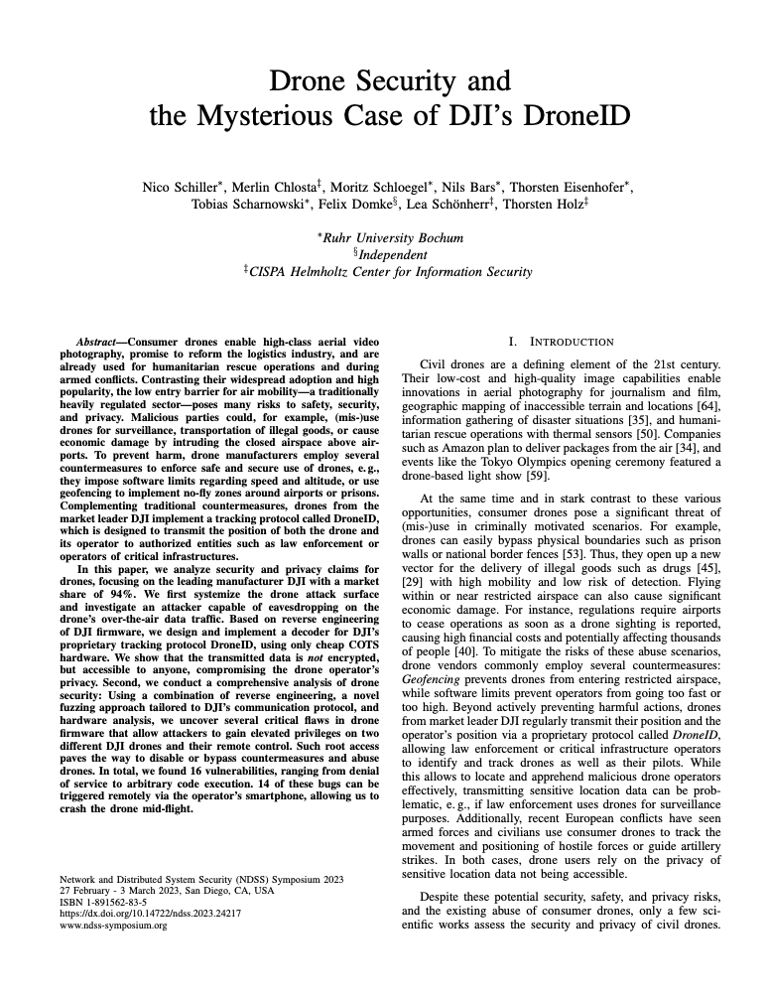
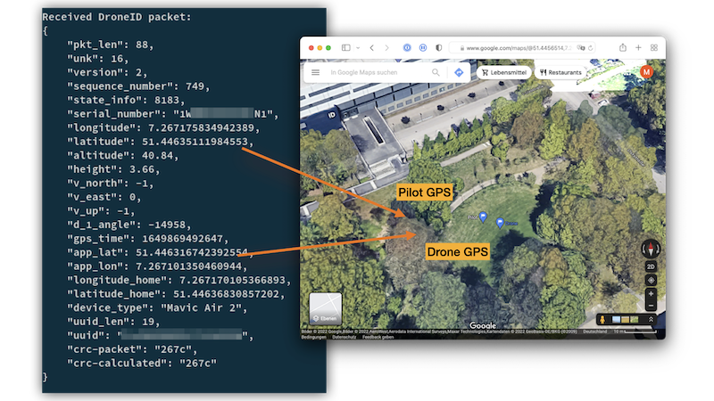
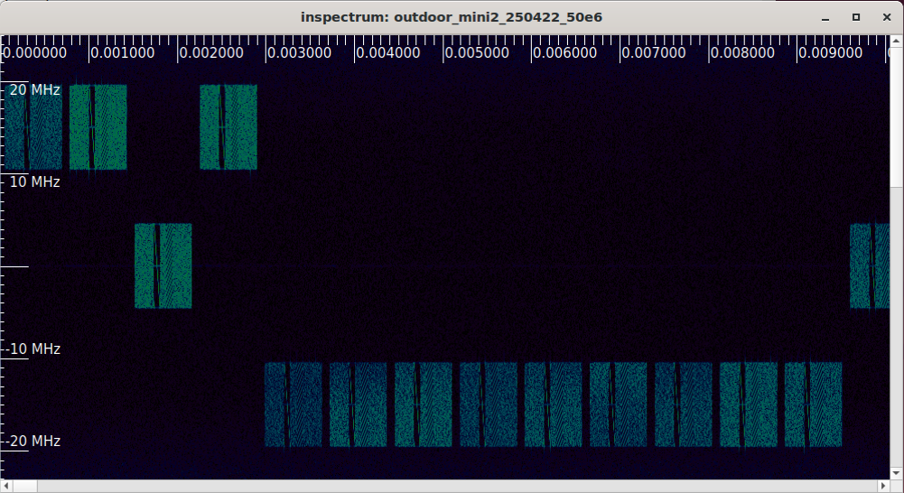
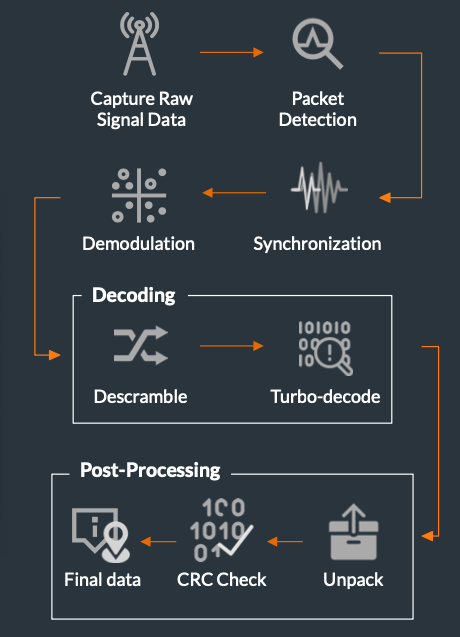

# Drone-ID Receiver for DJI OcuSync 2.0 - Windows Port

> **🔱 This is a Windows-compatible fork** of [RUB-SysSec/DroneSecurity](https://github.com/RUB-SysSec/DroneSecurity)  
> **📄 Original Paper:** [Drone Security and the Mysterious Case of DJI's DroneID (NDSS 2023)](https://www.ndss-symposium.org/wp-content/uploads/2023/02/ndss2023_f217_paper.pdf)  
> **👥 Original Authors:** Nico Schiller, Merlin Chlosta, Moritz Schloegel, et al. (Ruhr University Bochum)

---

## 🎯 What's New in This Fork

This fork adds **Windows support** and **BladeRF A4 hardware** compatibility to the original Linux/USRP implementation:

### Hardware Support
- ✅ **BladeRF A4** - Nuand BladeRF A4 / 2.0 micro xA4 (Windows & Linux)
- ✅ **USRP B205-mini** - Original Ettus USRP support maintained (Linux)
- ✅ **GNU Radio osmosdr** - Hardware abstraction for multiple SDRs

### Platform Support
- ✅ **Windows 10/11** - Full native Windows support
- ✅ **Linux** - Original Linux support maintained
- ✅ **Cross-platform paths** - Windows-compatible file handling

### Performance Improvements
- ⚡ **Faster STFT** - Optimized packet detection (33% faster)
- ⚡ **Early exit** - Stop processing after finding packets
- ⚡ **Reduced I/O** - Optional file saving for maximum speed
- ⚡ **Frequency locking** - Automatic lock to active frequencies

### Features
- 📊 **JSON output** - Structured telemetry with timestamps
- 🎯 **Frequency scanner** - Intelligent frequency hopping with locking
- 📝 **Comprehensive docs** - Detailed system overview and troubleshooting
- 🧪 **Test suite** - Property-based testing with pytest + hypothesis

### Tested Configuration
- **Hardware:** BladeRF A4, BladeRF 2.0 micro xA4
- **OS:** Windows 10/11, Ubuntu 20.04+
- **Drones:** DJI Mini 2, Mavic Air 2, Mavic 2 (legacy mode)
- **Python:** 3.8, 3.9, 3.10, 3.11

---

## 📖 Original Project

This receiver implements the DroneID protocol reverse-engineering from the NDSS 2023 paper:

**"Drone Security and the Mysterious Case of DJI's DroneID"**  
*Nico Schiller, Merlin Chlosta, Moritz Schloegel, Nils Bars, Thorsten Eisenhofer, Tobias Scharnowski, Felix Domke, Lea Schönherr, Thorsten Holz*

The original project provides:
- Complete DroneID protocol specification
- OFDM demodulation and QPSK decoding
- Zadoff-Chu sequence detection
- Turbo decoder implementation
- Sample captures for testing

**Original Repository:** https://github.com/RUB-SysSec/DroneSecurity

---

## 📚 Installation Guides

**Choose your platform:**

- **[Windows Installation Guide](INSTALLATION_GUIDE_WINDOWS.md)** - Complete setup for Windows 10/11
  - Python, GNU Radio, BladeRF drivers
  - Step-by-step with troubleshooting
  - ~45-60 minutes

- **[Linux Installation Guide](INSTALLATION_GUIDE_LINUX.md)** - Complete setup for Ubuntu/Debian
  - Python, GNU Radio, UHD/BladeRF
  - Performance tuning tips
  - ~20-30 minutes

- **[Platform Comparison](PLATFORM_COMPARISON.md)** - Windows vs Linux technical analysis
  - Why Linux performs better
  - USB performance differences
  - Sample drop explanations
  - Optimization recommendations

## 🚀 Quick Start

### Windows (Quick)

```powershell
# 1. Install Python 3.11 from python.org
# 2. Install GNU Radio (Radioconda recommended)
# 3. Install BladeRF drivers with Zadig

# Clone and setup
git clone https://github.com/Skeletoskull/DroneSecurity.git
cd DroneSecurity
python -m venv .venv
.venv\Scripts\activate
pip install -r requirements.txt

# Run receiver
python src\droneid_receiver_live.py --gain 55
```

**⚠️ For detailed instructions, see [INSTALLATION_GUIDE_WINDOWS.md](INSTALLATION_GUIDE_WINDOWS.md)**

### Linux (Quick)

```bash
# Install dependencies
sudo apt install python3 python3-pip gnuradio gr-osmosdr bladerf

# Clone and setup
git clone https://github.com/Skeletoskull/DroneSecurity.git
cd DroneSecurity
python3 -m venv .venv
source .venv/bin/activate
pip install -r requirements.txt

# Run receiver
python src/droneid_receiver_live.py --gain 55
```

**⚠️ For detailed instructions, see [INSTALLATION_GUIDE_LINUX.md](INSTALLATION_GUIDE_LINUX.md)**

### Test with Sample Files (No Hardware)

```bash
# Works on both Windows and Linux
python src/droneid_receiver_offline.py -i samples/mini2_sm
```

---

## 📚 Documentation

- **[SYSTEM_OVERVIEW.md](SYSTEM_OVERVIEW.md)** - Complete system architecture and signal flow
- **[DJI_DroneID_Live_Receiver_Pipeline.md](DJI_DroneID_Live_Receiver_Pipeline.md)** - Processing pipeline details
- **[Original README](#)** - See below for original project documentation

---

## 🤝 Contributing

Contributions are welcome! This fork aims to:
1. Maintain compatibility with the original project
2. Add Windows/BladeRF support without breaking Linux/USRP
3. Improve performance while preserving accuracy
4. Keep code well-documented and tested

### Submitting Changes

1. Fork this repository
2. Create a feature branch (`git checkout -b feature/amazing-feature`)
3. Commit your changes (`git commit -m 'Add amazing feature'`)
4. Push to the branch (`git push origin feature/amazing-feature`)
5. Open a Pull Request

---

## 📜 License

This project inherits the **AGPL-3.0** license from the original RUB-SysSec/DroneSecurity project.

**Key requirements:**
- Source code must be provided to users
- Modifications must be disclosed
- Derivative works must use the same license
- Network use constitutes distribution

See [LICENSE](LICENSE) for full details.

---

## 🙏 Acknowledgments

- **Original Authors:** RUB-SysSec team at Ruhr University Bochum
- **Paper:** NDSS 2023 - "Drone Security and the Mysterious Case of DJI's DroneID"
- **Inspiration:** [proto17/dji_droneid](https://github.com/proto17/dji_droneid) - Parallel implementation

---

## ⚠️ Disclaimer

This software is provided for **research and educational purposes only**. The authors and contributors:
- Do not encourage or condone unauthorized drone tracking
- Are not responsible for misuse of this software
- Recommend compliance with local privacy and aviation laws
- Provide this as an academic artifact for reproducibility

---

# Original README Content

[Your existing README content continues below...]


# Drone-ID Receiver for DJI OcuSync 2.0

<p><a href="https://www.ndss-symposium.org/wp-content/uploads/2023/02/ndss2023_f217_paper.pdf"></a></p>

This project is a receiver for DJI's Drone-ID protocol. The receiver works either live with an SDR, or offline on pre-recorded captures.

Our paper from NDSS'23 explains the protocol and receiver design: [Drone Security and the Mysterious Case of DJI's DroneID](https://www.ndss-symposium.org/wp-content/uploads/2023/02/ndss2023_f217_paper.pdf) [pdf]

> If you're looking for the fuzzer, we will upload that shortly :)

The live receiver was tested with:
* **BladeRF A4** (Windows support)
* Ettus USRP B205-mini (Linux support)
* DJI mini 2, DJI Mavic Air 2

Our software is a proof-of-concept receiver that we used to reverse-engineer an unknown protocol. Hence, it is not optimized for bad RF conditions, performance, or range.

<p></a></p>

## Sample Files

We provide sample files in the `samples/` folder.

The samples were directly dumped from the first stage of the live receiver that
*detects* candidate frames and performs no other data processing; it usually hands
them directly to the rest of the code that you can test offline.

You can use `inspectrum` to visualize the raw sample file:

```
sudo apt install inspectrum
inspectrum -r 50e6 samples/mini2_sm
```

</a></p>

## Quick Start (Offline)

Create a virtual environment for Python and install the requirements:

```
python3 -m venv .venv
source .venv/bin/activate
pip3 install -r requirements.txt 
```

You can now run the decoder on the sample file:
```
./src/droneid_receiver_offline.py -i samples/mini2_sm
```

### Results

The script performs detection and decoding just as the live receiver would. It prints the decoded payload for each Drone-ID frame:

```json
## Drone-ID Payload ##
{
    "pkt_len": 88,
    "unk": 16,
    "version": 2,
    "sequence_number": 878,
    "state_info": 8179,
    "serial_number": "SecureStorage?",
    "longitude": 7.267960786785307,
    "latitude": 51.446866781640146,
    "altitude": 39.32,
    "height": 5.49,
    "v_north": 0,
    "v_east": -7,
    "v_up": 0,
    "d_1_angle": 16900,
    "gps_time": 1650894901980,
    "app_lat": 43.26826445428658,
    "app_lon": 6.640125363111847,
    "longitude_home": 7.26794359805882,
    "latitude_home": 51.446883970366635,
    "device_type": "Mini 2",
    "uuid_len": 0,
    "uuid": "",
    "crc-packet": "c935",
    "crc-calculated": "c935"
}
```

The summary contains decoding stats and flight path. In the `mini2_sm` sample, the drone did not have GPS coordinates locked yet, and only the smartphone's location is transmitted:
```
$ ./src/droneid_receiver_offline.py -i samples/mini2_sm
… … …
Frame detection: 10 candidates
Decoder: 9 total, CRC OK: 7 (2 CRC errors)
Drone Coordinates:
App Coordinates:
(51.447176178716916, 7.266528392911369)
(51.447176178716916, 7.266528392911369)
…
(51.447176178716916, 7.266528392911369)
```

For `samples/mavic_air_2` both locations are transmitted:
```
$ ./src/droneid_receiver_offline.py -i samples/mavic_air_2
…
Decoder: 1 total, CRC OK: 1 (0 CRC errors)
Drone Coordinates:
(51.44633393111904, 7.26721594197086, 12.8)
App Coordinates:
(51.44620788045814, 7.267101350460944)
```

# Live Receiver

The live receiver requires an SDR device and **quite powerful machines** (for captures at 50 MHz bandwidth).

## Windows Setup with BladeRF A4

The receiver now supports BladeRF A4 hardware on Windows.

### Hardware Requirements
* BladeRF A4 SDR (or BladeRF 2.0 micro xA4)
* USB 3.0 port
* Windows 10 or later

### Step 1: Install BladeRF Drivers

1. Download and install [Zadig](https://zadig.akeo.ie/) for USB driver installation
2. Connect your BladeRF A4 device
3. Run Zadig as Administrator
4. Select **Options → List All Devices**
5. Select your BladeRF device from the dropdown
6. Choose **WinUSB** as the target driver
7. Click **Install Driver** or **Replace Driver**

### Step 2: Install Python Dependencies

Create a virtual environment and install requirements:

```powershell
python -m venv .venv
.venv\Scripts\activate
pip install -r requirements.txt
```

The `requirements.txt` includes:
- `bladerf` - Official Nuand Python bindings for BladeRF
- `hypothesis` - Property-based testing framework
- `pytest` - Testing framework
- Standard dependencies: `numpy`, `scipy`, `matplotlib`, `bitarray`, `crcmod`

### Step 3: Verify BladeRF Installation

Test that your BladeRF device is detected:

```powershell
python -c "from bladerf import _bladerf; sdr = _bladerf.BladeRF(); print('BladeRF detected:', sdr.serial)"
```

If successful, you should see your device's serial number.

### Step 4: Run the Receiver

Run the live receiver with default settings:

```powershell
python src\droneid_receiver_live.py
```

### Usage Examples

**Basic usage with automatic gain control:**
```powershell
python src\droneid_receiver_live.py --gain 0
```

**Manual gain control (30 dB):**
```powershell
python src\droneid_receiver_live.py --gain 30
```

**Adjust scan duration per frequency (2 seconds):**
```powershell
python src\droneid_receiver_live.py --duration 2.0
```

**Enable debug output:**
```powershell
python src\droneid_receiver_live.py --debug
```

**Support for legacy drones (Mavic Pro, Mavic 2):**
```powershell
python src\droneid_receiver_live.py --legacy --gain 50
```

**Note:** Mavic 2 and Mavic Air 3 require the `--legacy` flag!

**Adjust worker processes for parallel processing:**
```powershell
python src\droneid_receiver_live.py --workers 4
```

### Command-Line Options

| Option | Default | Description |
|--------|---------|-------------|
| `--gain` | 0 (AGC) | RX gain in dB (0 for automatic gain control, 1-60 for manual) |
| `--sample_rate` | 50e6 | Sample rate in Hz (50 MHz recommended) |
| `--workers` | 2 | Number of parallel worker processes |
| `--duration` | 1.3 | Sample duration per frequency in seconds |
| `--debug` | False | Enable debug output and visualization |
| `--legacy` | False | Support legacy drone models (Mavic Pro, Mavic 2) |

### How It Works

The receiver:
1. Scans through 2.4 GHz and 5.8 GHz frequency bands used by DJI drones
2. Detects DroneID packet bursts using time-domain power analysis
3. Locks to a frequency when packets are detected
4. Decodes OFDM symbols, performs QPSK demodulation, and extracts telemetry
5. Outputs decoded drone information in JSON format

### Troubleshooting

**"BladeRF device not found"**
- Ensure the device is connected to a USB 3.0 port
- Verify WinUSB driver is installed using Zadig
- Try a different USB port or cable

**"Device busy or in use"**
- Close any other applications using the BladeRF (e.g., SDR#, GQRX)
- Restart your computer if the device remains locked

**Poor reception or no packets detected**
- Increase gain: `--gain 40`
- Ensure antenna is connected
- Move closer to the drone
- Try different frequencies by adjusting scan duration

**High CPU usage**
- Reduce worker count: `--workers 1`
- Reduce sample duration: `--duration 1.0`

## Linux Setup with USRP (Legacy)

The original implementation supports Ettus USRP B205-mini on Linux.

Environment:
* Ettus USRP B205-mini
* DJI mini 2, DJI Mavic Air 2

First, setup the Python environment. Due to the UHD driver, this does not work with a virtual environment. If you previously activated a virtual environment, exit that environment first. Install Python requirements:
```
pip3 install -r requirements.txt
```

Install UHD:
```
sudo apt install libuhd-dev uhd-host python3-uhd
```

Run the receiver:

```
./src/droneid_receiver_live.py 
```

The receiver will hop through a list of frequencies and, if a drone is detected, lock on that band.

## Deeper Dive: Script output

<p></a></p>

> If you're looking for a deeper dive into the processing steps, we suggest calling the offline decoder with `--debug`. This will **enable a GUI** with step-by-step decoding.

> ```
> ./src/droneid_receiver_offline.py -i samples/mini2_sm --debug
> ```


First, the `SpectrumCapture` class performs *packet detection* and splits the capture file into individual frames:
```
Packet #0, start 0.000076, end 0.000721, length 0.000644, cfo -12207.031250
Packet #1, start 0.000811, end 0.001456, length 0.000644, cfo 0.000000
Packet #2, start 0.001546, end 0.002191, length 0.000644, cfo 0.000000
…
```

Some of these packets are false-positives and we do not expect successful decoding. Start and end are in seconds, so you can use inspectrum to take a look at individual frames.

Next, the `Packet` class detects the Zadoff-Chu sequences and performs time and frequency offset corrections. It splits the frames into individual OFDM symbols.
```
FFO: -6546.528614
Found ZC sequences: 600 147
ZC Offset: -2.867868
```

The `Decoder` class gets the OFDM symbols and demodulates the subcarriers using QPSK. We do not know the QPSK orientation here, hence, we simply brute-force the orientation. `decoder.magic()` performs the descrambling and turbo-decode.

`DroneIDPacket` unpacks the resulting bitstream into the Drone-ID struct. At this point the message could be decoded, but might be corrupted (CRC check needed).

CRC check FAIL is easy to spot by looking at the Serial Number (should read 'SecureStorage?'):
```
    "serial_number": "Sa#upeStore&q?\u0010\b",
    …
    "crc-packet": "d985",
    "crc-calculated": "9b01"
}
CRC Check FAILED!
```

At the very end, we print some statistics:
```
Successfully decoded 14 / 34 packets
4 Packets with CRC error
```

So in total we decoded 18 packets, 14 with correct CRC. Again, this is *expected* as the sample file includes Drone-ID Frames with greatly varying quality.

# FAQ - Frequently Asked Questions

Is DJI's Drone-ID the same as the standardized, Bluetooth or WiFi-based "Remote ID"?
> No. DJI uses a dedicated wireless protocol for its Drone-ID, hence the need to implement an receiver.

Can I use *this software* to locate drones from other manufacturers?
> No. This software decodes DJI-specific protocols. It does not work with WiFi or Bluetooth-based "Remote ID".

Can I locate drones without this software?
> Maybe. Since late 2022, the US or EU started requiring drone manufacturers to implement "Drone Remote ID" - an international standard that works on top of WiFi or Bluetooth. You can use a smartphone app to locate drones that support the standard. New drones already feature WiFi/Bluetooth-based "Remote ID", and existing drones are gradually retrofitted (e.g., through firmware updates).

Where can I find more information on the WiFi/Bluetooth-based Remote ID?
> Standard documents in EU: EN 4709, US: ASTM F3411.
> For practical information, check out [this page](https://www.faa.gov/uas/getting_started/remote_id/drone_pilots) by the FAA. If you're looking for an open-source implementation (e.g., Android apps), we suggest [opendroneid.org](https://www.opendroneid.org) and their [Github repositories](https://github.com/opendroneid).

Are you going to improve the receiver, introduce new features, or port to another SDR?
> We're not planning to include new features at this point. The tool is provided as artifact along our academic paper and enables researchers to reproduce our results, and to help study the privacy implications. It is not meant for productive, reliable localization of drones.

Is your receiver the only receiver available?
> No. The code in [proto17/dji_droneid](https://github.com/proto17/dji_droneid) was developed in parallel. We think it's great and if you're interested in details, you should take a look at both implementations.

# Citing the Paper

If you would like to cite our work, use the following BibTex entry:
```
@inproceedings{schiller2023drone,
  title={Drone Security and the Mysterious Case of DJI's DroneID},
  author={Schiller, Nico and Chlosta, Merlin and Schloegel, Moritz and Bars, Nils and Eisenhofer, Thorsten and Scharnowski, Tobias and Domke, Felix and Sch{\"o}nherr, Lea and Holz, Thorsten},
  booktitle={Network and Distributed System Security Symposium (NDSS)},
  year={2023}
}
```
